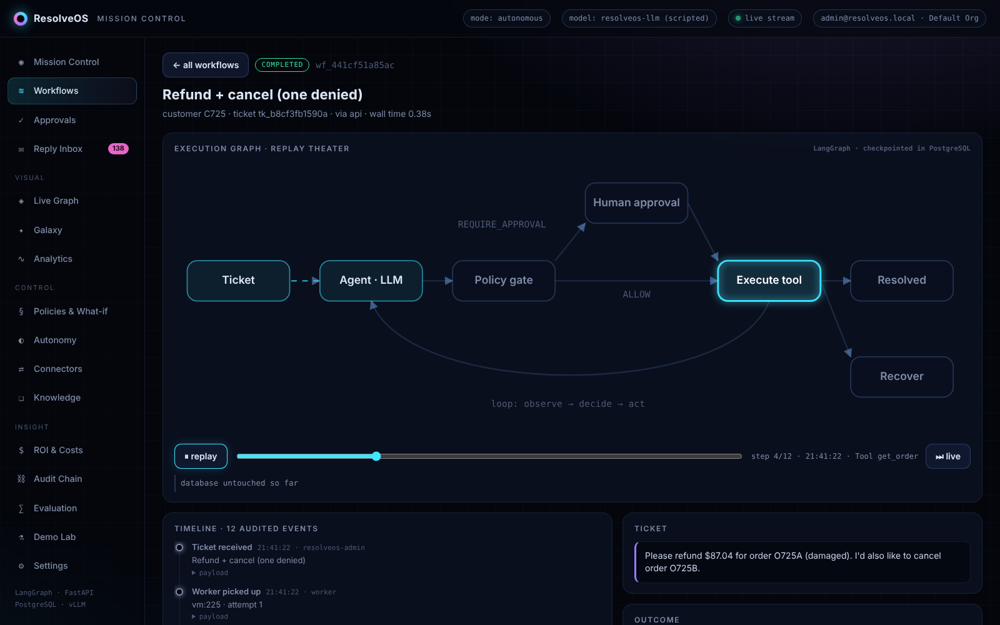
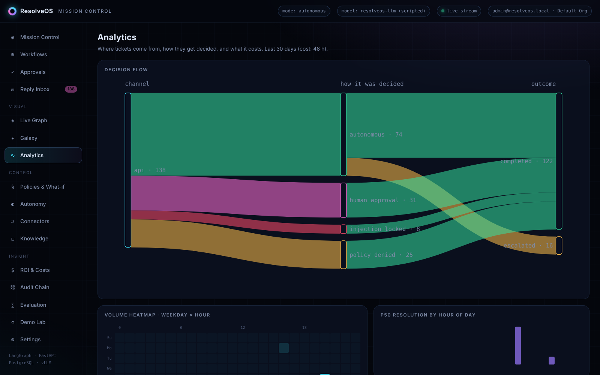
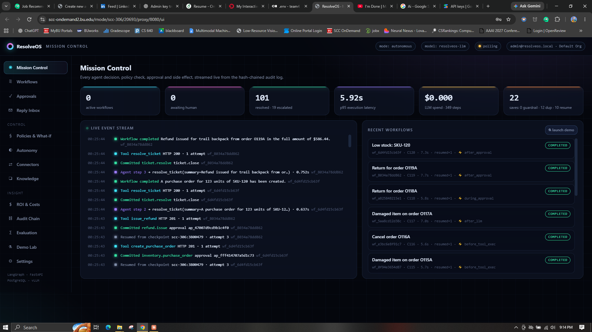
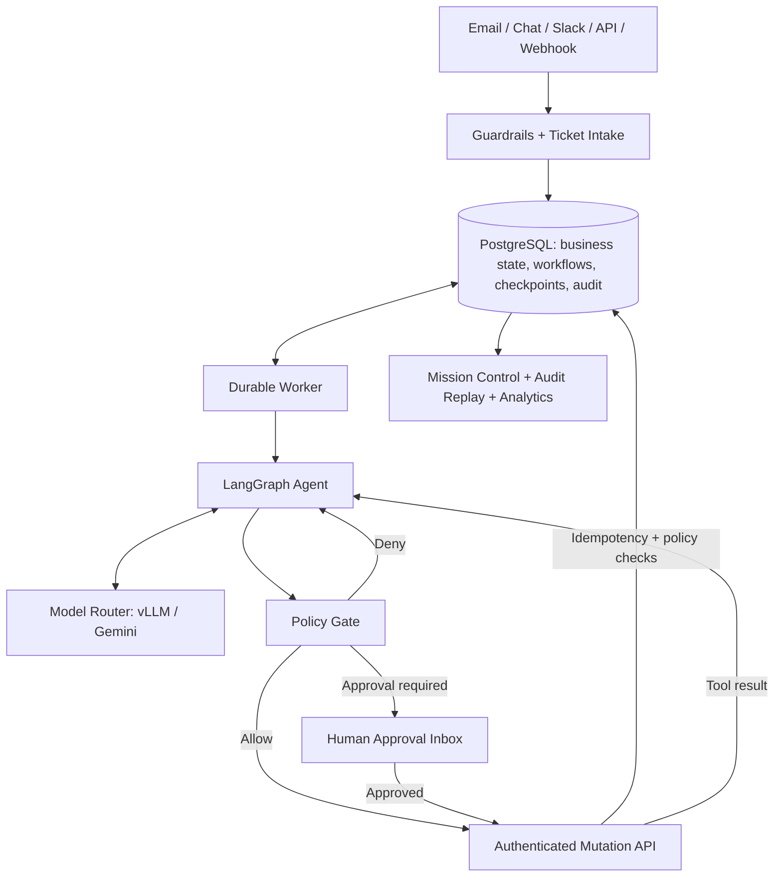

<div align="center">


# ResolveOS

**Autonomous AI operations, with guardrails built into execution.**

Turn operational requests into policy-checked actions with LangGraph agents, human approvals, durable workflows, and a visual audit trail.

[](https://www.python.org/)
[](https://www.langchain.com/langgraph)
[](https://fastapi.tiangolo.com/)
[](https://www.postgresql.org/)
[](#models-and-runtime)
[](#license)

[Explore the architecture](#architecture) · [See the demo gallery](#mission-control-gallery) · [Run locally](#running-locally) · [Understand the safeguards](#safety-and-limitations)

</div>

---

## In motion


<sub>This is a motion montage built from actual UI screenshots, **not** a recording of live mouse interactions. Screenshots show an evaluation/demo environment; some show scripted LLM mode.</sub>

## The idea

Most AI assistants stop at an answer. **ResolveOS is designed to carry a request through an operational workflow:** retrieve relevant business data, propose a tool action, enforce policies, request approval when necessary, execute with idempotency protection, and leave evidence that can be inspected afterward.

> **Request → Agent → Policy Gate → Human Approval (if needed) → Verified Action → Audit + Reply**

A customer asking for a refund may need a real refund, a denial, or a human sign-off—not another chatbot response. In ResolveOS, the policy checks live at the authenticated API mutation boundary, not merely in the prompt.

## What makes it different

| Capability | What it does |
| :--- | :--- |
| **Policy-gated execution** | Deterministic allow / deny / require-approval decisions before side effects. |
| **Human-in-the-loop** | Hash-bound, single-use, time-limited approvals with separation of duties. |
| **Durable agents** | Postgres-backed LangGraph checkpoints, leases, retries and recovery. |
| **Idempotent mutations** | Replays a previously committed response rather than duplicate an action. |
| **Tamper-evident audit** | Append-only, hash-chained operational events with verification. |
| **Operator observability** | Workflow Replay Theater, Live Graph, Operations Galaxy and decision analytics. |
| **External integration path** | OpenAPI connector discovery, intake channels, knowledge retrieval, reply drafting. |
| **Model routing** | Configurable local vLLM / Qwen and strong hosted model, with usage accounting. |

## Mission Control gallery

### 01 · Replay Theater — inspect an agent's decisions



A workflow-level timeline with a graph and replay slider showing audited steps, tool execution and approval branches.

### 02 · Operations Galaxy — understand the system


Live-inspired force visualization mapping intake, tools, policy denials and guardrails around an operations core.

### 03 · Live Graph — see the executable topology


The execution graph visualizes the system's LangGraph state transitions, rather than an unrelated architecture mockup.

### 04 · Analytics — see the outcomes



Decision flow, volume heatmap, and latency distribution surfaces for understanding how cases are handled.

<details>
<summary><strong>Earlier Mission Control screenshot</strong></summary>



</details>

## Architecture



**Design principle:** the agent uses the same authenticated REST interfaces as other clients. It does not get unrestricted direct access to business tables. Business mutations re-check policy and consume approvals atomically.

## Models and runtime

| Component | Technology |
| --- | --- |
| API and service layer | Python 3.10+, FastAPI, Uvicorn |
| Agent | LangGraph, tool calling, durable worker |
| State and checkpoints | PostgreSQL |
| Local inference | vLLM serving Qwen2.5-7B-Instruct on supported GPUs |
| Strong/hosted model | Gemini via configurable compatible endpoint |
| Observability and UI | Server-sent events / polling fallback, vanilla JS Mission Control |
| Packaging | Docker + deployment manifests |

**Important:** the screenshot header `resolveos-llm (scripted)` identifies a scripted demonstration/evaluation configuration, **not live Gemini reasoning**. To run real inference, configure and verify the provider endpoints and keys privately. Do not commit secrets.

## Evaluation evidence

A documented **earlier baseline** evaluated **Qwen2.5-7B-Instruct on an A100** with **120 synthetic templated scenarios**, using final database state and expected policy behavior as the success criterion.

| Historical baseline | Recorded result |
| --- | ---: |
| Task success | **119 / 120 (99.2%)** |
| p95 execution latency | **5.9 seconds** |
| Audit chains verified | **100%** |
| Idempotent duplicate actions prevented | **12** |
| Crash resumes in suite | **10** |

These are **synthetic benchmark measurements**, not production reliability claims; current v5 + Gemini results should be evaluated separately. See [`docs/PROJECT_GUIDE.md`](docs/PROJECT_GUIDE.md) and the evaluation scripts for methodology and caveats.

## Running locally

The codebase is designed for a Linux host / SCC-like GPU environment. Review the included scripts before running them in your environment.

```bash
# From the project root
bash scripts/00_setup.sh           # one-time install
bash scripts/01_postgres.sh        # PostgreSQL service
bash scripts/02_vllm.sh            # only for local GPU/vLLM runtime
bash scripts/03_services.sh        # API and worker
curl -fsS http://127.0.0.1:8080/healthz
bash scripts/06_ui.sh              # prints the Mission Control URL
```

Open `/ui` through your environment's authorized port forwarding. If you configure a hosted Gemini-only run, you need to adapt the local-model dependency and validate all model and worker settings first.

For environment-specific details and runtime scripts, consult the project guide and `deploy/DEPLOY.md` (where present).

## Safety and limitations

This is an **engineering portfolio / demonstration system**, not a ready-made production finance or refund service.

- The business domain currently uses demo records. Real systems require secure connector integration and testing.
- Some business tables are not fully multi-tenant isolated; isolate them before multi-customer hosting.
- Knowledge retrieval starts with Postgres lexical full text (not full hybrid semantic retrieval).
- Injection detection is heuristic and cannot guarantee protection against unseen attacks.
- Operational KPIs in screenshots come from test/demo data. Never interpret them as revenue claims.
- **Before public deployment:** rotate previously exposed credentials, enforce role-based access, HTTPS, request limits, isolated environments, audit retention, and abuse prevention; disable chaos/fault injection outside controlled testing.

## Roadmap

- [x] Workflow Replay Theater, Live Graph, Operations Galaxy and Analytics visualizations (v5 UI)
- [x] Policy enforcement, human approvals, durable workflows and audit verification
- [ ] Independent plan verification before multi-step execution
- [ ] Stronger tenant isolation and production security hardening
- [ ] Real external connector deployment and end-to-end integration tests
- [ ] More realistic ambiguous/adversarial evaluation and v5 model-router benchmarks
- [ ] Research-grade multi-agent and confidence-calibrated execution

## Project contents

- `resolveos/` — application, agent, policy, audit, API, UI and evaluation modules
- `scripts/` — setup, service orchestration, demos and benchmarks
- `deploy/` — container and hosting references
- `docs/assets/` — authentic UI screenshots, animations, optional concept art
- `tools/` — public-release ignore/preflight helpers from the GitHub kit

## License

No license is granted by default unless a `LICENSE` file is added. If you want others to reuse or distribute this code, choose an appropriate license explicitly.

---

<div align="center">

**ResolveOS** — *Let agents execute. Keep policies in control. Make every decision inspectable.*

<sub>Built as an applied AI engineering project. Real screenshots and documented synthetic evaluation; no production performance claims.</sub>

</div>
