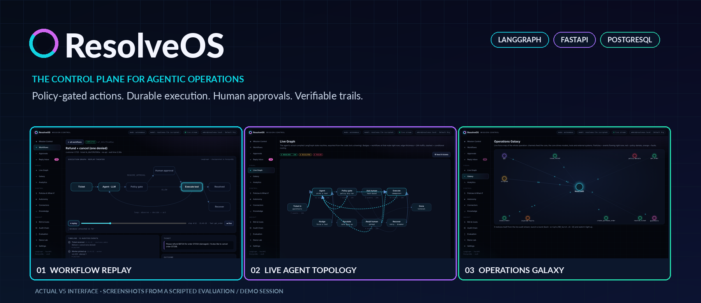
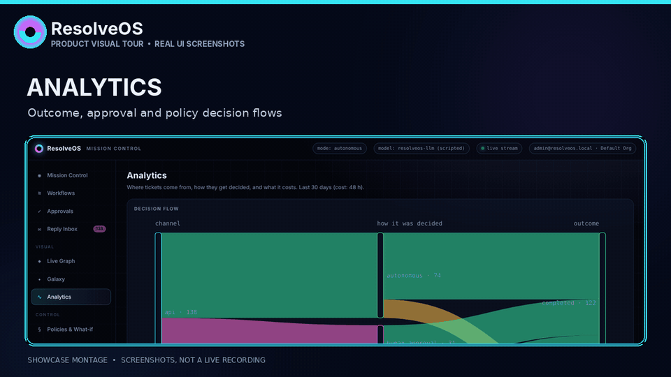
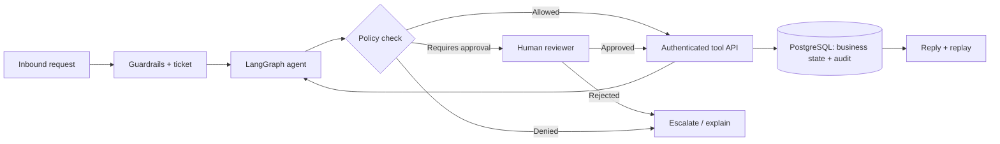
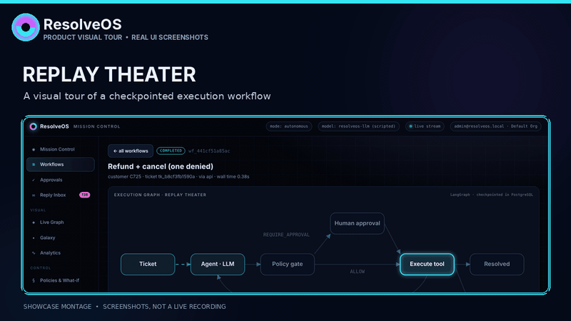
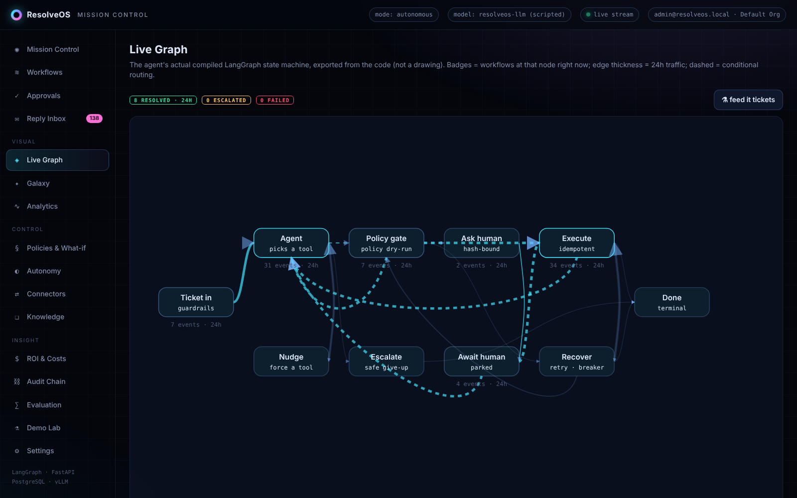
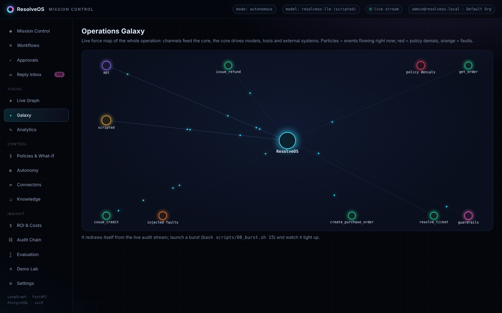
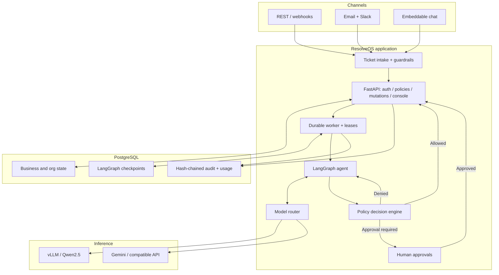

<div align="center">



# ResolveOS

### Agents that act. Policies that govern. Evidence you can replay.

**A stateful AI operations platform for turning business requests into controlled, recoverable, auditable actions.**

[](https://python.org)
[](https://github.com/langchain-ai/langgraph)
[](https://fastapi.tiangolo.com)
[](https://www.postgresql.org)
[](#model-modes)
[](#limitations--responsible-use)

[**Product tour**](#watch-resolveos-v5) · [**Explore the UI**](#mission-control--the-operator-experience) · [**Architecture**](#architecture) · [**Evidence**](#evaluation--honest-numbers) · [**Run it**](#quickstart-bu-scc--linux-gpu)

</div>

---

## Watch ResolveOS v5



> **Real application screenshots, shown in full.** This GIF is a visual montage, **not** a screen recording. The screenshots are from a demo/evaluation session displaying `resolveos-llm (scripted)`; they are not proof that Gemini or a local LLM executed those exact runs.

## What are we actually building?

A conventional support chatbot can *recommend* that an order should be refunded. **ResolveOS is designed to carry a request through the operation itself:** inspect records, select an authorized tool, check business policy, seek approval if necessary, execute safely, and leave an explainable record of what occurred.

**The product promise is not unchecked autonomy. It's inspectable autonomy.**

| A request comes in | What ResolveOS does |
|---|---|
| **“My order arrived damaged. Can I get a refund?”** | Read the order, validate eligibility, check limits, refund only if policy permits, then record the result. |
| **“Cancel order B, and refund order A.”** | Evaluate each proposed action independently; one action may complete while another is denied or escalated. |
| **“Inventory for SKU-120 is running out.”** | Read inventory, evaluate the proposed purchase order, and require a human when thresholds demand it. |
| **“The worker crashed halfway through.”** | Resume from a persisted checkpoint; retry a mutation under a stable idempotency key instead of blindly duplicating it. |

### One ticket. A complete chain of control.



The key design decision: **policy is enforced again inside the mutating API**, not just inside the LLM's prompt or an optional agent-side gate. The agent interacts with authenticated REST endpoints; it does not receive direct database-write privileges.

---

## Mission Control — the operator experience

No static architecture wallpaper here. ResolveOS v5 includes four visual surfaces backed by the application and its stored events.

### 01 / Replay Theater — inspect the execution, not just the answer


**Follow an individual ticket from input to outcome.** See graph state, policy branches, approvals, tool execution and the audited timeline, with a replay scrubber. The example shown is **“Refund + cancel (one denied)”**—exactly the kind of mixed outcome that makes explicit policy checks valuable.

<details>
<summary><b>Watch the replay-focused animated callouts</b></summary>



<sub>Animated highlights over a real UI screenshot, not a live recording or a simulated agent decision.</sub>

</details>

### 02 / Live Graph — the actual LangGraph topology



The visualization is generated from the **compiled LangGraph topology** via `/v1/graph/topology`—with `/v1/graph/live` providing current occupancy and 24-hour event traffic. Conditional paths, recovery, approval parking and terminal states are shown together.

### 03 / Operations Galaxy — the system from above



A force-map view links intake, tool activity, policy denials and faults. It's a visual observability surface for operational activity—not a substitute for the detailed audit trail.

### 04 / Analytics — where requests went, and why


The decision Sankey follows **channel → decision path → outcome**. The page also exposes volume by weekday and hour, latency by hour, and other insights backed by stored workflow and usage data.

<sub>Gallery imagery reflects demo/evaluation data, not production transactions or real customer revenue.</sub>

---

## Built for execution, not only orchestration

| Layer | What exists in v5 | Why it matters |
|---|---|---|
| **Agent runtime** | LangGraph state machine, tool calling, bounded steps, model router | Handles multi-step requests without giving the model unrestricted authority. |
| **Policy engine** | Built-in limits, custom rules, shadow/progressive/autonomous modes | Enforces business requirements as code, including allow / deny / approval. |
| **Approval workflow** | Signed / time-limited approvals, exact-action binding, separation of duties | A model cannot simply approve its own dangerous action. |
| **Durability** | PostgreSQL checkpoints, leased workers, heartbeats, crash resume | Jobs can survive worker interruption and regain progress. |
| **Transactional writes** | Idempotency keys, approval consumption and business writes in one transaction | Retries should not create duplicate refunds or orders. |
| **Auditability** | Append-only, hash-chained audit records and verification endpoint | Each workflow produces evidence that can be checked. |
| **Integrations** | OpenAPI REST connectors, API/webhook/email/Slack intake, chat widget | Moves beyond a single hard-coded business workflow. |
| **Operator tools** | Reply Inbox, Demo Lab, policies + what-if, knowledge, ROI and costs | Connects agents to a usable operations product. |
| **Observability** | Mission Control, replay, live topology, Galaxy, Sankey, `/metrics` | Makes execution and failure states visible. |

### A deeper look at the safety boundary

1. **Validate** the request and redact supported sensitive patterns before ticket persistence.
2. **Propose** an action through LangGraph's agent/tool loop.
3. **Check** the requested operation against deterministic policy and current workflow state.
4. **Park for approval** when necessary; approvals are tied to the action and relevant arguments and expire.
5. **Commit or reject** within an authenticated mutation API. Idempotency records and side effects share the database transaction.
6. **Record and resume** via checkpoints, worker leases and append-only audit events.

The existing guardrails are meaningful controls, **not a claim that an LLM is infallible or that all prompt injections are stopped**.

---

## Architecture



**Source map**

| Area | Files to inspect |
|---|---|
| LangGraph state machine | [`resolveos/agent/graph.py`](resolveos/agent/graph.py), [`resolveos/agent/tools.py`](resolveos/agent/tools.py) |
| Model routing and clients | [`resolveos/agent/llm.py`](resolveos/agent/llm.py), [`resolveos/agent/client.py`](resolveos/agent/client.py) |
| Policy and mutation safety | [`resolveos/policy.py`](resolveos/policy.py), [`resolveos/api/mutation.py`](resolveos/api/mutation.py) |
| Durable worker and storage | [`resolveos/worker.py`](resolveos/worker.py), [`resolveos/db.py`](resolveos/db.py), [`resolveos/schema.sql`](resolveos/schema.sql) |
| Auth, audit, guardrails | [`resolveos/auth.py`](resolveos/auth.py), [`resolveos/audit.py`](resolveos/audit.py), [`resolveos/guardrails.py`](resolveos/guardrails.py) |
| UI and graph insights | [`resolveos/ui/index.html`](resolveos/ui/index.html), [`resolveos/api/insights.py`](resolveos/api/insights.py) |
| Tests and benchmark | [`tests/`](tests/), [`resolveos/eval/`](resolveos/eval/) |

---

## Evaluation — honest numbers

The project guide records an **earlier baseline**, run with **Qwen2.5-7B-Instruct on an NVIDIA A100** over **120 synthetic, templated cases**. The evaluation checks **final database state and expected approval behavior**, not whether an LLM merely produced a convincing answer.

| Historical benchmark (pre-v4 router) | Result |
|---|---:|
| Correct final task outcomes | **119 / 120 (99.2%)** |
| Execution latency, p50 / p95 / p99 | **2.1s / 5.9s / 9.8s** |
| Verified audit chains | **100%** |
| Duplicate mutations prevented | **12** |
| Crash recoveries | **10** |
| Failure | **1 case safely escalated instead of retried** |

**Read before quoting:** these figures belong to the *documented earlier A100 run*, not the new v5 visual tour or the current Gemini configuration. Cases were synthetic and partly templated; they are not evidence of production accuracy. A harder ambiguous/adversarial evaluation and a fresh v5 router benchmark are still needed.

See [`docs/PROJECT_GUIDE.md`](docs/PROJECT_GUIDE.md) and [`resolveos/eval/`](resolveos/eval/) for the methodology and test harness.

---

## Quickstart: BU SCC / Linux GPU

Requirements: Python 3.10+, Linux, sufficient GPU resources for local inference, and access to install dependencies/model weights. The included scripts were written for a BU SCC-style environment and use a bundled PostgreSQL distribution inside a virtual environment.

```bash
# Clone the repository and enter it
 git clone https://github.com/Delimiter-Ashish/resolveOS.git
 cd resolveOS

# One-time setup (including the substantial vLLM/GPU dependencies)
 bash scripts/00_setup.sh
 bash scripts/download_model.sh

# Start components on the same compute node
 bash scripts/01_postgres.sh
 bash scripts/02_vllm.sh
 bash scripts/03_services.sh

# Verify and open the UI through your authorized proxy / forwarded port
 curl -fsS http://127.0.0.1:8080/healthz
 bash scripts/06_ui.sh
```

**SCC note:** `127.0.0.1:5433` is node-local PostgreSQL. Start PostgreSQL and API/worker on the same compute node, or deliberately configure an accessible database address. OnDemand port proxying or SSH port forwarding is required to view `/ui` on your laptop.

Useful commands:

```bash
bash scripts/08_burst.sh 15    # load-test the demo event stream
bash scripts/04_eval.sh        # run the 120-scenario evaluation
pytest -q tests               # unit tests in the active venv
bash scripts/99_stop.sh        # stop processes started by the scripts
```

**Never run destructive evaluation or fault-injection tests against a shared/production database.** See [`DEMO.md`](DEMO.md) for a guided walkthrough.

### Model modes

| Mode | Configuration | Appropriate use |
|---|---|---|
| **Scripted** | `RESOLVEOS_LLM_MODE=fake` | Pipeline/UI smoke testing, **not** an LLM intelligence benchmark. |
| **Local inference** | vLLM OpenAI-compatible endpoint (`RESOLVEOS_LLM_BASE_URL`) | A100 / GPU experiments with Qwen2.5 or another tool-capable model. |
| **Gemini** | `RESOLVEOS_STRONG_LLM_*` in private `.env`, router mode `strong` / `auto` as appropriate | Hosted reasoning with provider billing, rate limits and actual model configuration. |

The local SCC scripts set a vLLM URL and start a model process. A hosted Gemini-only deployment requires a separately validated deployment configuration; **do not assume the SCC shell scripts work unchanged on Render/Railway**. The existing `deploy/` folder is a starting point, not a production-certified deployment.

Copy [`.env.example`](.env.example) to a local **untracked** `.env` and provide any model credentials there. Never commit API keys, bootstrap passwords, `.env.keys`, runtime files, or model weights.

---

## Deployment and security

ResolveOS has Docker and hosting manifests in [`deploy/`](deploy/), but **public hosting should only follow security hardening and isolation**:

- Replace and revoke any API keys or bootstrap credentials exposed during development. Use new platform secrets and strong admin credentials.
- Disable public signup unless explicitly required (`RESOLVEOS_ALLOW_SIGNUP=false`), serve via HTTPS, enforce rate limits, and protect admin/metrics endpoints.
- Ensure `RESOLVEOS_CHAOS_ENABLED=0` for any publicly accessible instance; SCC scripts currently default this on for demo runs.
- Use an isolated PostgreSQL database with backups, proper secrets management and safe failure behavior.
- Address incomplete tenant isolation in the demo business tables before multi-customer use.
- Start new organizations in **shadow** mode; require human review for consequential actions.

No live public deployment is claimed by this README. A demo URL should be added only after it is actually reachable and tested.

## Limitations & responsible use

- Demo business tables and connectors are **not** equivalent to integrations with a real payment processor, ERP or CRM.
- Some business records remain shared across organizations even though the product layer is org-scoped.
- Knowledge retrieval currently uses PostgreSQL full-text/lexical ranking, not a full embedding + reranker pipeline.
- Prompt-injection defenses are heuristic and require more adversarial evaluation.
- The screenshots show **scripted-mode demo runs**. LLM quality and safety need separate measurement with actual providers.
- This is an engineering prototype; assess compliance, privacy, authorization and side-effect safety independently before real-world use.

## Roadmap

- [x] Real executable LangGraph topology visualization
- [x] Workflow Replay Theater, Operations Galaxy and decision analytics
- [x] Policy-gated, idempotent, checkpointed agent execution
- [x] Multi-channel intake, connector tools, reply drafting and audit verification
- [ ] Plan → verify → execute with cross-tool invariants
- [ ] Stronger tenant isolation and end-to-end production security hardening
- [ ] Genuine external sandbox integration and deployment regression tests
- [ ] Harder real-LLM evaluation, attack resilience and calibrated escalation
- [ ] Optional multi-agent specialist routing and measurable cost/performance ablations

## License

No open-source license has been specified yet. Unless a license is added, this repository is **source-available, not automatically licensed for reuse or redistribution**.

---

<div align="center">

**ResolveOS** — *Autonomy you can supervise. Actions you can verify.*

<sub>Built and evaluated as an applied AI systems project. Demo interfaces and historical synthetic benchmarks are explicitly identified.</sub>

</div>
